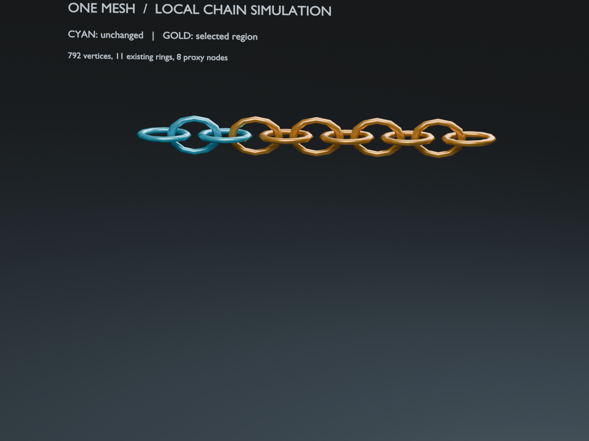
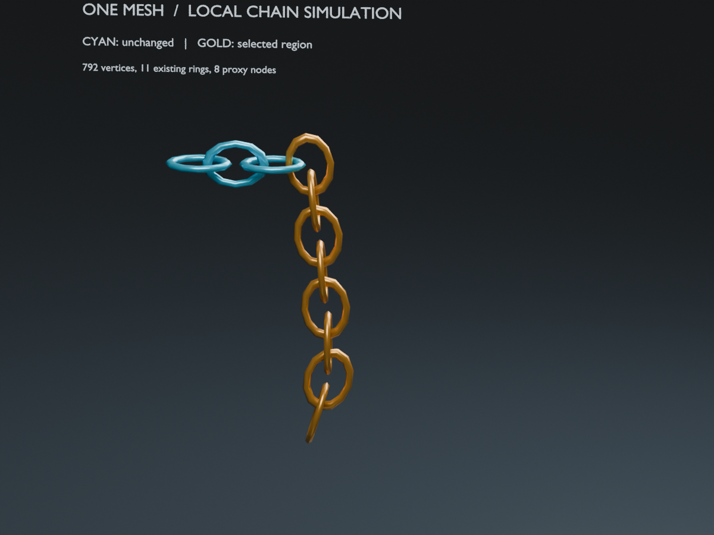
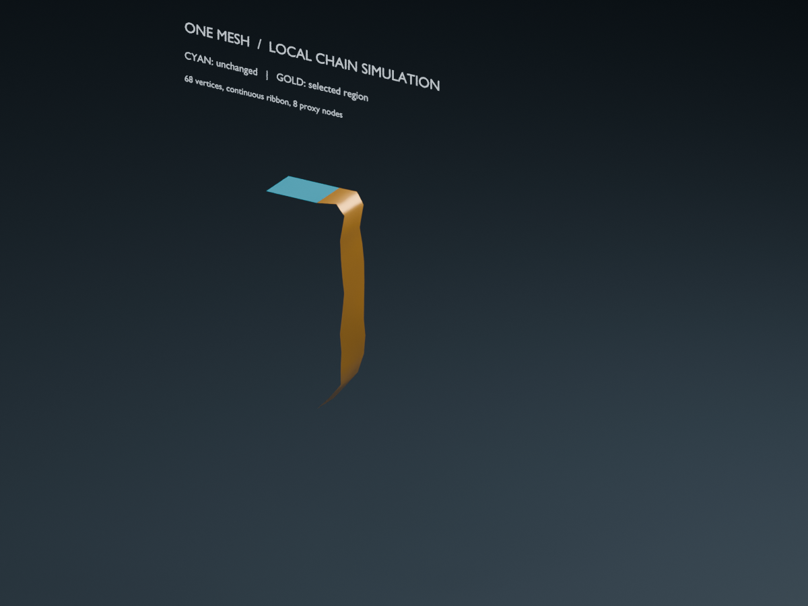
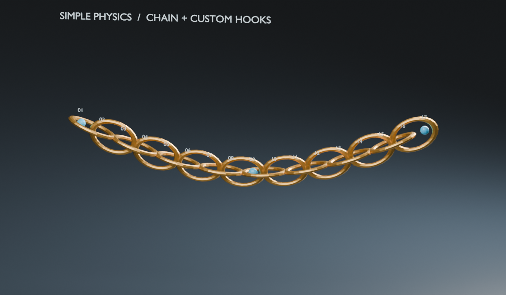
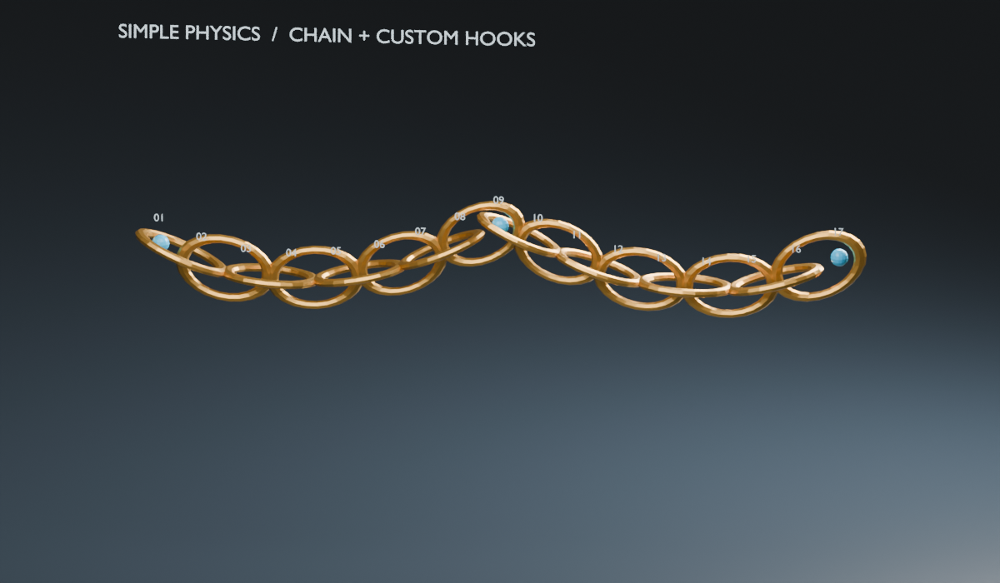
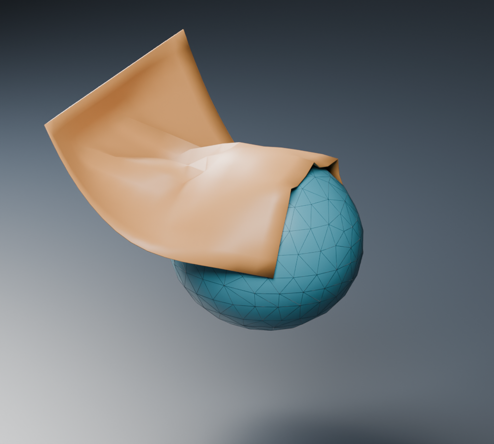
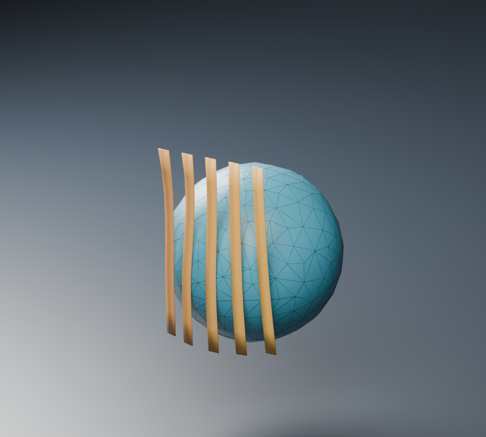
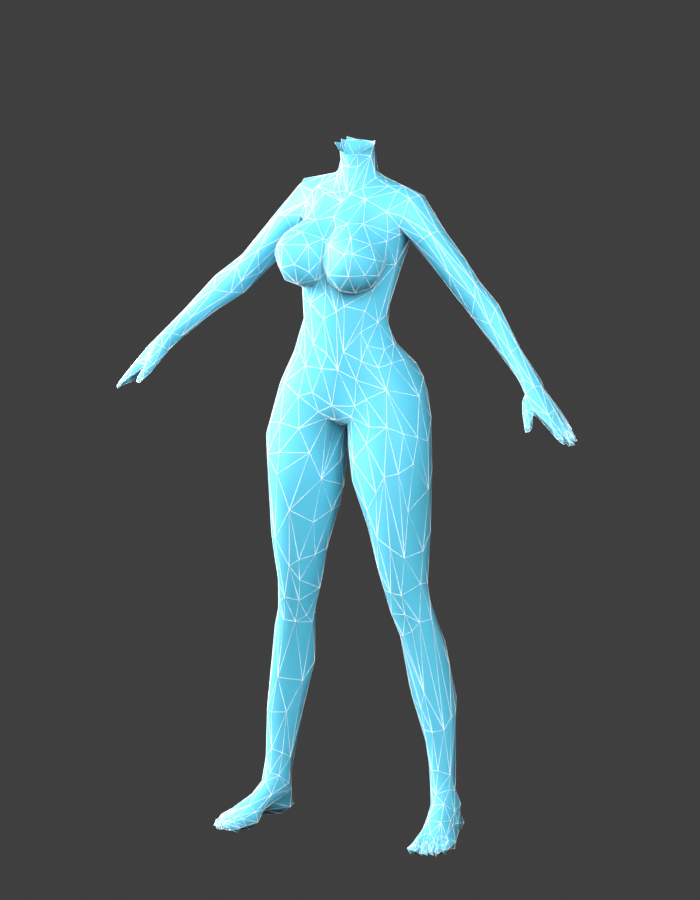
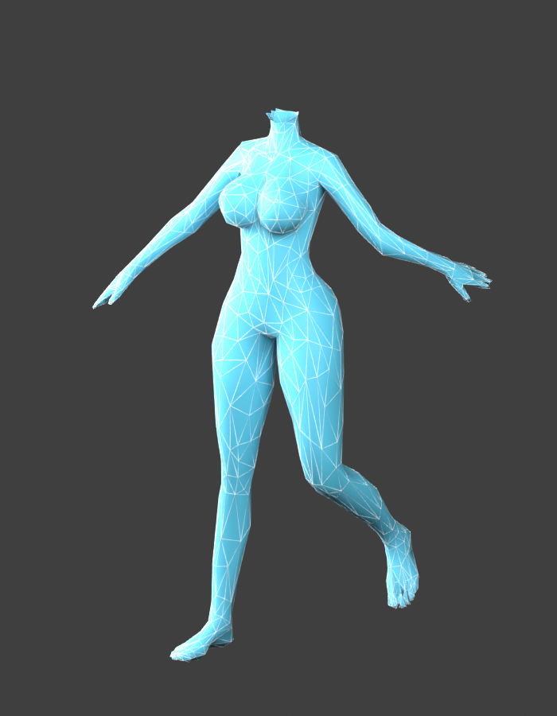

# Simple Cloth Simulation 1.3.1 · 物理合集

在原来的 **N → Simple Cloth** 中统一身体局部抖动、头发 / 衣摆、悬吊链条、碰撞和缓存。扩展 ID 沿用 `simple_cloth_simulation`，无需另外安装一套插件。

**状态：已构建、未验收。** 已检查链条、布片、独立发束及实际角色低模碰撞体预览。胸部 / 大腿 / 臀部参数是可调起点，尚未以实际角色长动画验收，不等同于 Jiggle Maker 的效果复刻。

[下载 1.3.1 预览版与可编辑示例](https://github.com/DuckFeather10086/simple_cloth_simulation/releases/tag/v1.3.1-preview.1)。安装后重启 Blender，入口仍为 **N → Simple Cloth**。

## 链条主入口：给原 Mesh 的选区添加模拟

默认入口为 **悬吊链条 → 原 Mesh 的选区**。目标是只让同一 Mesh 里指定的部分参与模拟，仍然输出原来的一个 Mesh。

1. 在原 Mesh 编辑模式选中需要模拟的部分。
2. **连续网格**用于绳、带、鞭身、垂挂饰物：选择代理节点数与选区边缘过渡圈数。**独立链环**用于同一 Mesh 内已经建好的链环：选完整链环，每个环生成一个代理节点。
3. 选 **头部 Hook / 尾部 Hook / 两端 Hook**，点 **生成模拟**。自动生成动画参考路径、软体代理和原网格的局部驱动；选区外的顶点不参与该驱动。预设端点会有可移动的 Hook，初始跟随原动画。
4. 选择代理上的编号球，在 **Hook 目标**里指定物体 / Empty / 骨架和骨骼。端点和中间点都能指定；目标为空则新建控制点。
5. 原网格保持一个 Mesh。连续网格沿路径平滑弯曲；独立链环保持环内距离，只逐环转动和移动。骨架动画与模拟按相对变化叠加，避免双倍位移。
6. 同一 Mesh 可建立多个互不重叠的区域。选原 Mesh 可管理它的全部区域；选某个代理或编号球只管理对应区域。移除模拟恢复原输入，不删除原网格或手工指定的 Hook 目标。

以下是同一个原 Mesh：青色三个链环未选中，金色八个链环参与模拟。没有重新排列或复制渲染链环。







代理按选区主要延伸方向 / 相邻链环中心自动排序。当前适合单条延伸路径；强回折、分叉或多条交错路径应分开选区。独立链环模式不会把只选半个环偷偷扩选为整个环，而是报错提示。原动画应保持顶点对应关系；已有原生 Cloth / Soft Body 或拓扑变化位于动画之前的修改器栈需先准备可对应的输入。局部模拟网格不能同时作为自己的碰撞物，身体 / 障碍物需使用独立碰撞 Mesh，避免循环依赖。模拟使用代理弹簧，尚不保证逐环机械互扣、自碰撞或严格不可伸长。

## 辅助入口：新建代理并排列链节外观

选择 **独立代理 / 新建链条**，用于从中心线创建新链条外观；已有 Mesh 选区使用上面的主入口。

1. 模式选 **悬吊链条 → 独立代理 / 新建链条**。在游标处新建代理，或选择已有的绳中心线 Mesh；Tab 编辑路径。自动排列外观目前要求单条开放边链。
2. 选 **头部 Hook / 尾部 Hook / 两端 Hook**，点 **生成模拟**。固定点会有独立 Hook，代理每个顶点显示编号球。头尾按代理路径编号区分；需要中间固定点时手动加 Hook。
3. 选择任意编号球（可多选），或 Tab 选代理顶点。在 **Hook 目标**指定已有物体 / Empty；选骨架时可再指定骨骼。点 **指定 Hook**。留空目标则新建控制点。
4. 绑定时保留当前偏移，不会把代理点瞬移到目标原点。改绑同一节点会移除它在旧 Hook 中的影响，其余节点保留。目标可以动画；不要再用代理自身或它的节点标记作 Hook 目标。
5. 在 **链节模板**指定一件实际链节 Mesh，选择其长轴（默认 Y），点 **排列 / 更新链节**。每条代理边放一个链节，按中点和方向跟随模拟。支持交替旋转 90°、按节距等比缩放，以及节距 / 链节长度比例。
6. 外观模板共享 Mesh 数据，原模板保留原位。代理节点数改变后，清缓存、重新显示编号和排列链节。缓存默认只处理当前选择；可明确切到场景全部模拟。

**节点编号表示代理顶点；链节编号表示相邻节点之间的模型。** 想增加实际链节，就增加代理分段。悬吊位置可选端点或中间任意节点。准备后主要移动 Hook；只移动代理对象会改变它与世界空间 Hook 的关系。

下图是同一套真实模拟的第 1、24 帧：两端固定，第 9 节指定到可动画的 Hook，中间抬起。蓝球表示三个固定点。





求解的是代理弹簧，链节是随动外观；链节之间尚无逐环刚体接触，不能保证锁链机械互扣、碰撞厚度或严格不可伸长。链节外观必须留出模型适合的互扣间距。

## 身体局部抖动

选择身体 Mesh，模式选 **软体抖动**：

- 编辑模式选择局部顶点，回到面板选择胸部 / 大腿 / 臀部起点，生成模拟。边缘过渡圈数向选区内部平滑，选区外固定跟随原动画。
- 也可以指定已有权重组，权重越高抖动越明显；原组不会被改写。多个不相连的局部区域可以放在同一个权重组内。
- 使用独立 Goal 权重组和原生 Soft Body，放在已有变形之后、细分 / 厚度 / 外观节点之前。原始网格、蒙皮权重、形态键保留；移除模拟只移除本工具追加的修改器与组。
- 已有软体骨骼时，可在姿态模式选择骨骼生成单骨弹簧代理。此方式驱动已有骨骼，不会自动给大腿 / 臀部新建骨骼或分配权重。

这版网格抖动直接求解基础 Mesh，尚无自动低模体积代理。高密度身体应先用小范围试用；拓扑变化修改器位于骨架之前的复杂栈会明确报错，需要先准备可对应的模拟输入。当前不是体积肉体求解器。Goal 跟随动画的含义见 [Blender 官方说明](https://docs.blender.org/manual/en/latest/physics/soft_body/settings/goal.html)。

## 共同操作

**模拟参数 / 碰撞 / 缓存** 显示所选骨骼、网格、节点或 Hook 对应的实际求解器参数。直接调质量、抗拉、阻尼、回位、重力等；Cloth 另有抗弯、质量步数、碰撞间距、碰撞质量和自碰撞。

- 在物体模式选身体或障碍物，点 **添加碰撞物**。已有的用户 Collision 不会被接管，移除操作只移除本工具添加的 Collision。
- 时间范围采用场景起止帧。**烘焙** / **清除重置** 都能用于 Cloth 和 Soft Body；已烘焙时先清缓存，再改 Hook 和参数。
- **停用** 会同时绕过骨骼代理的反馈约束，让原骨骼动画恢复；启用重新接入。
- **移除当前范围的模拟** 保留输入 Mesh 和外部 Hook 目标。生成的节点 / 链节外观一起清理。用户仍引用的骨骼代理会保留并停用求解器。

鞭子的具体实现方向见 [鞭子方案](docs/WHIP_DESIGN.md)。它是下一步方案，1.3 尚未增加专用鞭子模式。

## 摆动布片与头发

模式选 **头发 / 衣摆**，结构选 **布片 / 衣摆**或**独立发束**：

- **已有骨链**：姿态模式选择需要摆动的骨链。布片将同父骨下相邻骨链织成一片；独立发束逐链生成窄带，发束之间不织面。根部跟随未选父骨，代理 Cloth 驱动原骨骼，已有蒙皮不重绑。
- **直接 Mesh 布片**：编辑模式只选固定边 / 根部，点生成；未选点参与 Cloth。也可指定已有固定权重组，权重 1 表示固定、0 表示自由。会复制为私有 Pin 组，保留用户组。这里的选点含义是固定点，与链条的“模拟区域”不同。
- **预设参数**：布片偏柔，发束增加抗弯；原生 Cloth 质量 12、碰撞质量 6，初始间距 0.003。参数可在统一面板继续调整。自碰撞默认关闭，需要时自行开启。
- 模拟保持 **已有变形 → Cloth → 细分 / 厚度** 的顺序。从起始帧连续播放；调参、换碰撞体或移动 Hook 后先清缓存再烘焙。

实际布片落到运动低模碰撞体上的第 35 帧：



五条独立发束代理，共用身体骨架和低模碰撞体；每条都单独求解：



目前骨链织面按局部 X 排列，环裙绕体排序和闭环缝合仍需手工处理。无骨骼的实体发束不是自动导发功能；可用已有骨链代理，或准备合适的带状 Mesh。

## 身体骨架低模碰撞体

1. 在物体模式选择已绑定骨架的身体 Mesh。
2. 在 **模拟参数 / 碰撞 / 缓存** 设置目标三角面数（默认 2500）和体表外扩（默认 0.003）。
3. 点 **生成骨架低模碰撞体**，生成独立的可编辑 Mesh，默认线框显示、渲染隐藏，自动启用 Collision。
4. 原身体继续保留；身体动画、蒙皮和形态键通过独立参考驱动低模。布片、头发、链条可以共同与这个低模碰撞。
5. 要改变面数 / 外扩，选碰撞体或对应身体，移除低模碰撞体后重新生成，再清理物理缓存。

拓扑只在生成时简化一次，动画时保持相同顶点和面。生成时按启用的顶点组 Mask 裁掉被隐藏的体表（例如换头后的原 DAZ 头）；独立头部需要单独选择其 Mesh 生成碰撞体。只读取身体物理之前的骨架、形态键和拓扑稳定变形，不把身体自身 Jiggle / 局部链条结果反馈回来。源身体的形态键和权重不会改写。

以下来自实际角色的身体：16,556 个顶点 → **854 个顶点 / 1,682 个三角面**，弯肘、屈膝后仍跟随。图中只渲染碰撞体；颈部开口来自原身体换头遮罩。





低模依然会评估一次身体的动画参考，减少的是碰撞求解面数。身体基础拓扑或遮罩范围改变后需重建；身体与父级缩放需先应用。体表有开口时仍有开口，不会自动补成闭合体积。外部 Geometry Nodes、拓扑变化以及合并的 graft 不属于此版的实时动画参考；它们需要独立碰撞体或先准备稳定的表面。碰撞间距与布片初始位置需留出空间；[Blender 官方碰撞设置](https://docs.blender.org/manual/en/latest/physics/cloth/settings/collisions.html)说明了求解质量和间距的作用。

## 原有头发 / 衣摆与高级骨链工具

安装扩展包，或把整个目录作为插件安装。姿态模式选骨，打开 **N → Simple Cloth**。

- **Weave & Parent Mesh**：按树形关系生成并替换所选骨的代理驱动。
- **Cloth**：布片模式将同父骨下的多条链织成一片；独立发束模式逐链生成带状网格。
- **Soft Body**：每条链生成独立的方截面壳体；支持头、尾 Hook 控制。
- **四面体骨骼代理**：每根选中骨生成一个方锥线框弹簧代理，底部跟随父骨、顶点驱动骨尾。沿用旧名称，不是体积四面体求解器。
- 代理网格编辑模式下 **Add Hook from Selection**：选点建控制，自动赋 Pin/Goal 满权重并放到物理修改器之前。
- **Delete All Guide Meshes**：清理所有本插件代理、插件 Track 和不再被其他 Hook 使用的控制空物体。

物理缓存起止帧采用场景范围。统一面板可直接管理碰撞、主要参数和缓存；全部底层参数仍可通过 Blender 原生物理面板调整。

## 骨树规则

1. 只处理所选骨；未选父骨保留为锚点。
2. 唯一的相连子骨延续同一列。
3. 在断开处或多个相连子骨的分叉处开始下一组；该组挂到对应父骨。
4. 同父骨下的列按骨架局部 X 排列；不同父骨分别成组。
5. 不等长列保留尾点并补三角面；Pin/Goal 衰减按每条链自己的弧长归一化。

当前多列排列仍适合平面链阵列；环裙绕体排序、闭环连接尚未实现。

## 替换与归属

- 只替换所选骨上以 **`SW_DampedTrack_`** 开头的插件 Track。旧版 Weaver 使用的同前缀约束也兼容。
- Blender Constraint 不支持 ID 自定义属性，因此此保留名称前缀就是约束归属标记。不要手工移除插件约束的前缀；普通用户 Track 即使指向同一代理也不因此被视为插件约束。
- 新代理通过自定义属性记录实例、骨架、骨集合及目标顶点组，改代理对象名称不影响识别。
- 生成时暂时静音旧插件 Track；成功后才移除旧 Track，并删除不再被其他骨或用户约束引用的旧代理。失败则恢复旧驱动、姿态及本次 Snap 修改。
- 部分骨重建保留仍供未选骨使用的旧代理。用户共享了旧代理或控制器时也会保留相应资源。
- 更早的、没有归属前缀的 Damped Track 无法与手工约束可靠区分，因此保留，不进行猜测性删除。

## 旧版兼容

- 旧 `object.simple_cloth_simulation` 入口仍可调用，现转到共享树形生成器并使用 Simple Cloth 面板参数。
- 旧 `simple_cloth_sim` 场景参数保留用于读档兼容，不再被 load handler 重置；旧 Chain Count/Thickness 等残留开关不再参与新生成。
- `bone swing.py` 保留为历史脚本启动入口，正式实现位于 `bone_swing.py`，随插件自动注册。
- 旧场景已有代理不会因打开文件自动修改；重建/清理由用户操作触发。

## 本次修复

精准替换 Track；生成失败回滚；旋转、缩放、已摆姿态下的世界坐标和父子绑定；分叉覆盖；焊接后顶点映射；共享顶点多骨目标组；Soft Body Hook 顺序和端点权重；控制器跟随父骨及资源清理；参数持久化；重复生成；骨名清理后保持绑定；四面体批量生成与无父骨跟随。

骨架非均匀缩放时父级逆矩阵保留完整变换，避免将剪切分解成平移/旋转/缩放而造成偏移。Cloth/Soft Body 都使用 Blender 原生求解器，没有替换求解器。

## 回归测试

```text
blender --background --factory-startup --python-exit-code 1 -P tests/test_blender.py -- --output-dir <临时输出目录>
blender --background --factory-startup --python-exit-code 1 -P tests/test_physics.py
blender --background --factory-startup --python-exit-code 1 -P tests/test_regions.py
blender --background --factory-startup --python-exit-code 1 -P tests/test_cloth_body.py
blender --background --factory-startup --python-exit-code 1 -P tests/preview_physics.py
blender --background --factory-startup --python-exit-code 1 -P tests/preview_regions.py
blender --background --factory-startup --python-exit-code 1 -P tests/preview_regions.py -- --continuous
blender --background --factory-startup --python-exit-code 1 -P tests/preview_cloth_body.py
blender --background --factory-startup --python-exit-code 1 -P tests/preview_cloth_body.py -- --hair
```

Blender 5.2.0 LTS 后台通过 **47 项回归**。原有 22 项覆盖 Hook 连续帧对照、部分骨重建、保留用户约束、异常回滚和保存重开。10 项覆盖实际碰撞、骨骼 / 物体 Hook、局部抖动与原动画叠加、形态键 / 权重保留、节点和链节随动、缓存重开、实际 UI 操作入口及清理归属。7 项覆盖原 Mesh 连续 / 独立链环选区、选区外保留、逐环刚性、原动画不双倍、Hook 绝对跟随、区域烘焙重开、多个区域隔离、编辑模式入口和失败回滚。8 项新增覆盖低模随蒙皮 / 形态键变形、排除原身体物理反馈、布片和同骨架发束的碰撞对照、烘焙重开、布料 / 碰撞体 UI、发束与织面的差异、三个 Hook 预设以及局部区域端点随动画。

另用实际角色的身体验证弯肘、屈膝后的固定拓扑和体表采样跟随；最大跟随误差约 3.4e-8 Blender 单位。该数值验证绑定正确，不代表简化表面对原体表的几何误差或保证无穿模。未用实际角色长动画验证碰撞稳定性；Blender 5.0/5.1 本轮未实测。

局部选区示例：`out/unified-physics/regions/local-chain-demo.blend`、`continuous-chain-demo.blend`。新建链条示例：`out/unified-physics/demo/chain-demo.blend`。逐环刚性实测环内距离最大变化约 8.2e-8 Blender 单位；局部抖动实测选区位移约 0.01145，选区外保持固定；链条地面碰撞对照：末端无碰撞 z=-0.15356，有碰撞 z=0.00285。这些是合成场景的数值证据，不是角色成品验收。

布片与发束示例：`out/unified-physics/cloth-body/cloth-body-demo.blend`、`hair-cloth-demo.blend`，均在 Release 提供可编辑附件。布片中心点在无 / 有身体碰撞的对照中，末帧高度分别约 0.596 / 0.816。实际角色的源资产不打进插件或示例包。
